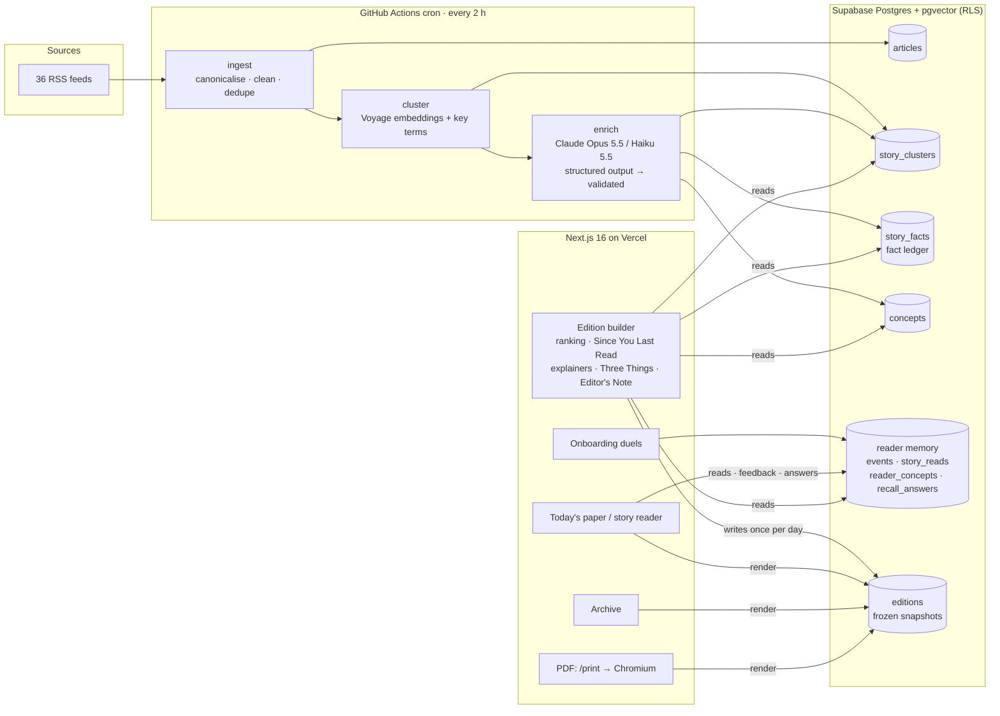

# The Morning Paper

**A personal newspaper that remembers what you already know.**

News is scattered across sites, apps and newsletters. We read too much and remember too little. The Morning Paper gives you one finite edition each morning, built by a personal editor with three kinds of memory:

- **Interests** — what you care about (from onboarding and your feedback).
- **Exposure** — which developing stories you've read, and when.
- **Knowledge** — which concepts you've met, and which facts you actually remembered.

Live: https://morning-paper-mocha.vercel.app · Sample paper: `/paper/demo` · PDF: `/api/pdf/demo`

## What makes it different

| A generic AI news app                     | The Morning Paper                                                                                                 |
| ----------------------------------------- | ----------------------------------------------------------------------------------------------------------------- |
| Summarises today's article                | **Since You Last Read** — for a story you've read before, shows only the facts that appeared after your last read |
| Explains every term to everyone           | **New to you** — explainers only for concepts you haven't met; they disappear as you learn                        |
| Endless feed that reshuffles as you click | **Finite, frozen edition** — your feedback shapes tomorrow's paper, never today's                                 |
| Hidden recommender                        | **Visible editor** — an Editor's Note and "why this is in your paper", both derived from real data                |
| Measures clicks                           | **Three Things** — a 3-question recall at the end; missed facts come back in a later edition                      |

## Features

- **Real news ingestion** — 36 live-probed RSS feeds (global, technology, AI/robotics, Pakistan, sport, science, health, crypto), every 2 hours. URLs canonicalised, HTML cleaned, length-capped, promo posts dropped, failures isolated per source.
- **Story clustering** — Voyage `voyage-4-lite` embeddings + key-term overlap group reports of the same developing story (86.8% on 129 hand-labelled headline pairs, recall 0.98). Offline hash-embedding fallback.
- **AI enrichment** — one structured-output call per story (Claude Opus 5.5 for the biggest, Haiku 5.5 for the rest): headline, brief, why it matters, key points, concept explainers, atomic timestamped facts for the fact ledger, and a recall question. Output is schema-validated and length-capped; failures fall back to deterministic copy.
- **Onboarding** — six duels between today's real headlines, a name and a reading length (5 / 15 / 25 minutes).
- **Personal ranking** — transparent weighted score (interest 0.40, importance 0.25, freshness 0.15, coverage 0.10, novelty 0.10), a reading budget, a diversity penalty and lead / major / standard / brief tiers. Two readers get different front pages from the same news.
- **Learning** — More / Less like this (strong) and opening a story (weak, capped) adjust interest weights for future editions.
- **Daily edition** — frozen per reader per day; reloading never reorders it.
- **Archive** — previous editions exactly as received.
- **Newspaper PDF** — the same snapshot rendered as an A4 three-column broadsheet with masthead, edition number, running headers and page numbers, printed by headless Chromium.

## Architecture



**AI vs deterministic code.** AI writes the copy and extracts facts, concepts and recall questions, once per story and shared by all readers. Everything about a specific reader is deterministic and explainable: ranking, interest weights, Since You Last Read (a fact-ledger query), which explainers to show, Three Things selection and the Editor's Note. So no per-reader LLM call is needed, and the editor can't claim something the system didn't learn.

**Since You Last Read, precisely.** Facts are stored per story with the time they first appeared. When you open a story, we record that you read it as of that edition. In a later edition, the story is shown as _continuing_ with only the facts whose `first_seen_at` is after your last read; stories you've read with nothing new are left out.

## Stack

Next.js 16 · TypeScript · Tailwind 4 · Supabase (Postgres 17 + pgvector, anonymous Auth, RLS) · Drizzle · Claude (Anthropic SDK, structured outputs) · Voyage AI · Playwright + @sparticuz/chromium (PDF) · Vitest · GitHub Actions · Vercel.

## Running it

```bash
npm install
cp .env.example .env.local      # fill in Supabase, DATABASE_URL, ANTHROPIC_API_KEY, VOYAGE_API_KEY
npm run db:migrate && npm run db:seed
npm run ingest && npm run cluster && npm run enrich
npm run dev
```

Useful scripts: `npm run env:check -- --ping` (verify keys without printing them), `npm run ingest:report` (data quality), `npm run stories` (inspect enriched stories), `npm run cluster:calibrate` (re-measure clustering).

**Demo history.** `npm run demo:seed` gives the most recent reader a _simulated_ day of reading on real news (yesterday's edition, a few stories read, one More / one Less, one missed recall answer) and then builds today's paper, so Since You Last Read, the Editor's Note and a resurfaced recall question can be shown in one sitting. Only the reader's past behaviour is simulated; every story and fact is real.

## Tests

```bash
npm run check        # lint + typecheck + format + unit tests
npm run test:e2e     # Playwright, including the golden path
```

The golden-path test drives a real reader through start → onboarding → first paper (stable on reload) → Three Things → story → feedback → PDF against the live project. RLS integration tests confirm readers can't read or write each other's data.

## Honest limits

- Clustering is about 87% accurate on our labelled set; related-but-distinct stories (e.g. successive fuel-price revisions) can merge.
- The fixture-mode fallback copy (used when the LLM is unavailable) is plainer than the AI briefs.
- Cut for time: natural-language "talk to your editor", implicit dwell/skip tracking, knowledge-graph visualisation and the stretch features in [SPEC.md](SPEC.md).

See [SPEC.md](SPEC.md), [PLAN.md](PLAN.md), [STATUS.md](STATUS.md) and [AGENTS.md](AGENTS.md).
